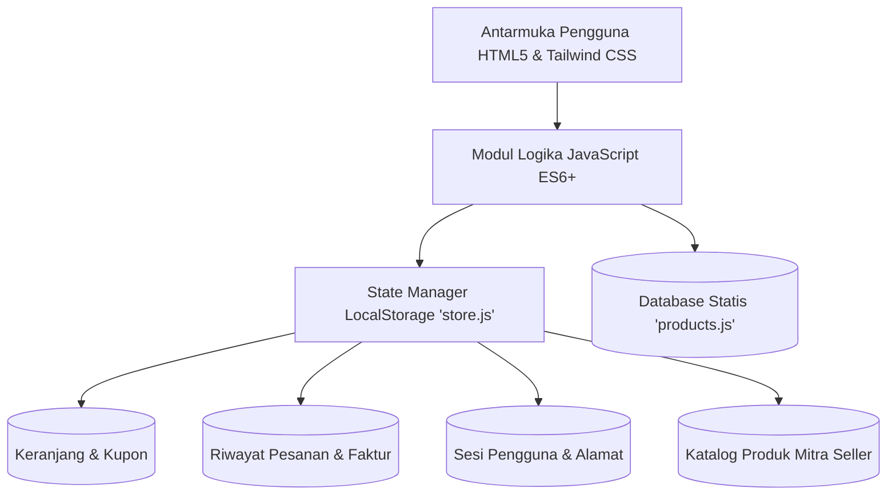

# 🧪 LabMart Indonesia — Platform Marketplace Pengadaan Alat & Bahan Laboratorium
> **Dokumentasi Lengkap Prototipe Interaktif (Interactive Web Prototype V1.0)**  
> *Solusi Pengadaan Bahan Kimia Analisis, Glassware Borosilikat, Instrumen Sains, dan Perlengkapan APD Laboratorium Terpercaya di Indonesia.*

---

## 📋 Daftar Isi
1. [Ringkasan Eksekutif & Identitas Platform](#1-ringkasan-eksekutif--identitas-platform)
2. [Tujuan Pembuatan Prototipe & Target Audiens](#2-tujuan-pembuatan-prototipe--target-audiens)
3. [Arsitektur Sistem & Spesifikasi Teknologi](#3-arsitektur-sistem--spesifikasi-teknologi)
4. [Daftar Lengkap Katalog Produk (Tier Terjangkau)](#4-daftar-lengkap-katalog-produk-tier-terjangkau)
5. [Fitur Unggulan Khas Pasar Indonesia & Pengadaan Sains](#5-fitur-unggulan-khas-pasar-indonesia--pengadaan-sains)
6. [Struktur Berkas & Direktori Proyek (File Tree)](#6-struktur-berkas--direktori-proyek-file-tree)
7. [Penjelasan Detail Tiap Halaman & Modul Sistem](#7-penjelasan-detail-tiap-halaman--modul-sistem)
8. [Manajemen State & Penyimpanan Lokal (LocalStorage Architecture)](#8-manajemen-state--penyimpanan-lokal-localstorage-architecture)
9. [Panduan Menjalankan Prototipe Secara Lokal](#9-panduan-menjalankan-prototipe-secara-lokal)
10. [Panduan Deployment ke Hosting Statis (GitHub Pages / Vercel)](#10-panduan-deployment-ke-hosting-statis-github-pages--vercel)
11. [Skenario Demo Interaktif untuk Presentasi ke Klien (Client Pitching Walkthrough)](#11-skenario-demo-interaktif-untuk-presentasi-ke-klien-client-pitching-walkthrough)
12. [Hasil Pengujian Sistem (Quality Assurance Summary)](#12-hasil-pengujian-sistem-quality-assurance-summary)

---

## 1. Ringkasan Eksekutif & Identitas Platform

* **Nama Platform:** **LabMart Indonesia (LabMart.id)**
* **Slogan / Tagline:** *"Pusat Marketplace Pengadaan Alat, Bahan Kimia & Perlengkapan Laboratorium Terpercaya di Indonesia"*
* **Versi Rilis:** Prototype V1.0 (Interactive Pre-Deployment Pitching Build)
* **Karakteristik Utama:** 100% Client-Side Interactive Prototype (Bebas ketergantungan server backend, siap dijalankan di browser manapun atau dihosting pada static hosting secara instan).

**LabMart Indonesia** dirancang khusus untuk mengatasi hambatan birokrasi, fragmentasi rantai pasok, dan kesulitan pencarian reagen kimia bersertifikasi resmi di Indonesia. Platform ini memadukan kemudahan berbelanja online bergaya e-commerce modern (seperti Tokopedia/Shopee) dengan kepatuhan standar Good Laboratory Practice (GLP), regulasi Bahan Berbahaya dan Beracun (B3), serta transparansi dokumen mutu seperti *Certificate of Analysis* (CoA) dan *Safety Data Sheet* (MSDS).

---

## 2. Tujuan Pembuatan Prototipe & Target Audiens

### Tujuan Prototipe:
1. **Validasi Kebutuhan Pengguna (User Need Validation):** Membuktikan alur pengadaan alat dan bahan lab dari hulu ke hilir (pencarian produk berdasar grade kemurnian, keranjang belanja dengan catatan lot reagen, pemilihan ekspedisi khusus, kanal pembayaran nasional, hingga e-Faktur A4 berstempel QC).
2. **Kesiapan Pitching Klien & Stakeholder:** Memberikan pengalaman interaktif langsung (klik-dan-coba) kepada calon klien, investor, atau dekanat institusi tanpa risiko kegagalan server database.
3. **Ergonomi Multi-Device:** Menguji kenyamanan antarmuka baik pada monitor desktop laboratorium maupun layar smartphone mahasiswa di ruang praktikum.

### Profil Target Pengguna (User Personas):
* **Mahasiswa Sains & Farmasi:** Membutuhkan bahan kimia dan alat gelas untuk praktikum atau tugas akhir skripsi dengan harga terjangkau (rentang Rp 6.000 s/d Rp 72.000) dan opsi pembayaran minimarket/QRIS.
* **Dosen, Peneliti & Pranata Laboratorium Pendidikan (PLP):** Memerlukan formalitas dokumen pengadaan seperti Surat Penawaran Resmi (RFQ), faktur berstempel QA/QC, serta jaminan CoA.
* **Quality Assurance (QA) & QC Manager Industri:** Memerlukan reagen tingkat analitik tinggi (Pro Analisis / PA), kemasan bersegel pabrik, dan pengiriman aman.
* **Mitra Toko Distributor Lab (Sellers):** Membutuhkan portal seller centre untuk memajang produk alat ukur, mengelola pesanan masuk, dan memperluas jangkauan pasar ke seluruh universitas di Indonesia.

---

## 3. Arsitektur Sistem & Spesifikasi Teknologi

Prototipe ini dibangun menggunakan arsitektur **Pure Client-Side Jamstack** yang ringan, cepat, dan modular:



### Spesifikasi Teknologi:
* **Struktur Markup:** HTML5 Semantik (Header, Main, Section, Nav, Aside, Footer, Form) yang ramah SEO dan aksesibilitas.
* **Styling Framework:** Tailwind CSS 3.x (melalui CDN resmi) dipadukan dengan modul `css/custom.css`.
* **Tipografi:** 
  * Font Teks Utama: **Plus Jakarta Sans** (Google Fonts) untuk keterbacaan modern dan bersih.
  * Font Angka & Finansial: **JetBrains Mono** untuk angka nominal rupiah, kode invoice, nomor virtual account, nomor resi kurir, dan kode batang (anti-ambigu).
* **Ikonografi:** Google Material Symbols Outlined (pemuatan font glyph instan).
* **Bahasa Pemrograman Logika:** Pure Vanilla JavaScript (Modern ES6+ Modules/Objects tanpa framework berat seperti React/Vue/Angular sehingga beban muat < 1 detik).
* **Penyimpanan State:** Browser Web Storage API (`localStorage`) yang persisten saat halaman di-refresh atau berpindah tab.
* **Kebutuhan Server:** **Zero Server-Side Language** (Tidak membutuhkan Node.js, PHP, Ruby, atau Python backend; dapat dibuka langsung melalui double-click file `.html` atau melalui local web server).

---

## 4. Daftar Lengkap Katalog Produk (Tier Terjangkau)

Seluruh produk instrumen jutaan rupiah dari versi awal telah dieleminasi. Sistem kini menyediakan **28 produk aktif** (20 item bahan dan alat praktikum berharga terjangkau persis sesuai instruksi pengguna, ditambah 7 item katalog asli yang berharga di bawah Rp 1 juta, serta 1 produk unggulan seller centre).

### A. 13 Bahan – Bahan Kimia Laboratorium (Sesuai Daftar Kebutuhan)
| ID SKU | Nama Bahan Kimia | Spesifikasi & Mutu | Kemasan | Harga Satuan |
|:---|:---|:---|:---|:---:|
| `LAB-001` | **Aquades 5L** | Air Demineralisasi Pro Analisis (TDS < 1 ppm) | Jerigen Segel HDPE 5L | **Rp 35.000** |
| `LAB-002` | **Isopropyl Alcohol 500 mL** | Isopropanol (IPA) Kemurnian 99.8% PA Grade | Botol Lab Gelap 500 mL | **Rp 30.000** |
| `LAB-003` | **Isopropyl Alcohol 1L** | Isopropanol (IPA) Murni 99.8% Segel Pabrik | Botol Kaca Segel 1.000 mL | **Rp 54.000** |
| `LAB-004` | **Alkohol 70% 1L** | Etanol Antiseptik & Desinfektan Lab LAF | Botol HDPE Bersegel 1 Liter | **Rp 48.000** |
| `LAB-005` | **White Oil 1L** | Minyak Mineral Parafin Cair Murni Tanpa Bau | Botol Lab Kedap 1 Liter | **Rp 50.000** |
| `LAB-006` | **Sodium Sulfite 1 kg** | Natrium Sulfit (Na2SO3) Murni Anhidrat | Kantong Kedap 1.000 g | **Rp 30.000** |
| `LAB-007` | **Polivinyl Alcohol Polimer 100 gram** | PVA Polimer Sintetis Hidrolisis Tinggi | Resealable Pouch 100 g (3.52 oz) | **Rp 30.000** |
| `LAB-008` | **Polivinyl Alcohol Polimer 500 gram** | PVA Serbuk Larut Air Panas Kemasan Praktikum | Toples Kedap Udara 500 g | **Rp 50.000** |
| `LAB-009` | **NaOH 1kg** | Natrium Hidroksida Flakes Murni 98% (Basa Kuat) | Kantong Segel Ganda 1 kg | **Rp 30.000** |
| `LAB-010` | **Cobalt Silicate 100 gram** | Kobalt Silikat (Co2SiO4) Sintesis Anorganik | Botol Spesimen 100 g | **Rp 72.000** |
| `LAB-011` | **Sodium Benzoat 1kg** | Natrium Benzoat Pengawet & Reagen Uji | Pack 1 Kilogram | **Rp 48.000** |
| `LAB-012` | **Sodium Sulfate 1 kg** | Natrium Sulfat Anhidrat (Zat Pengering Organik) | Pack Segel 1 kg | **Rp 12.000** |
| `LAB-013` | **Kalsium Karbonat 1kg** | CaCO3 Presipitasi Super Halus Mesh 800 | Pack Tebal 1 kg | **Rp 6.000** |

### B. 7 Alat – Alat Laboratorium (Sesuai Daftar Kebutuhan)
| ID SKU | Nama Alat Laboratorium | Spesifikasi Standar Teknis | Material Bahan | Harga Satuan |
|:---|:---|:---|:---|:---:|
| `LAB-014` | **Lateks anti panas** | Tahan suhu hingga 150°C, grip heksagonal | Lateks Karet Alam Tebal | **Rp 14.000** |
| `LAB-015` | **Gelas ukur kaca ukuran 25 mL** | DIN EN ISO 4788, Dasar Heksagonal Anti-Guling | Kaca Borosilikat 3.3 | **Rp 15.000** |
| `LAB-016` | **Gelas ukur kaca ukuran 50 mL** | Graduasi 1.0 mL Kontras Tinggi Tahan Gores | Kaca Borosilikat 3.3 | **Rp 28.000** |
| `LAB-017` | **Gelas ukur kaca ukuran 100 mL** | Silinder Ukur Kalibrasi Kelas B DIN 12331 | Kaca Borosilikat 3.3 | **Rp 50.000** |
| `LAB-018` | **Jerigen pembuangan limbah 1L** | Tutup Ganda Plug Stopper + Ulir Segel B3 | HDPE Tebal Anti-Pelarut | **Rp 10.000** |
| `LAB-019` | **Labu Ukur 50 mL** | Volumetrik Kelas A Terkalibrasi TC 20°C ISO 1042 | Kaca Borosilikat + Stopper PE | **Rp 30.000** |
| `LAB-020` | **Beaker Glass 150 mL** | Gelas Piala Low-Form Tahan Pemanasan Hotplate | Kaca Borosilikat 3.3 | **Rp 15.000** |

### C. 7 Produk Asli Dipertahankan (< Rp 1.000.000)
| ID SKU | Nama Produk | Kategori | Harga Satuan |
|:---|:---|:---|:---:|
| `LAB-021` | **Etanol (Ethyl Alcohol) 96% PA Grade 1L** | Bahan Kimia & Reagen | **Rp 345.000** |
| `LAB-022` | **Labu Erlenmeyer Borosilikat 3.3 250ml & 500ml** | Alat Kaca & Plastik | **Rp 68.000** |
| `LAB-023` | **Jas Laboratorium Lengan Panjang Katun Drill Tebal** | Perlengkapan APD & Safety | **Rp 135.000** |
| `LAB-024` | **Asam Sulfat (H2SO4) 98% PA Grade 2.5L** | Bahan Kimia & Reagen | **Rp 890.000** |
| `LAB-025` | **Kacamata Safety Goggles Anti-Splash Kimia UV400** | Perlengkapan APD & Safety | **Rp 65.000** |
| `LAB-026` | **Media Nutrien Agar (Nutrient Agar - NA) 500g** | Bahan Kimia & Reagen | **Rp 520.000** |
| `LAB-027` | **Sarung Tangan Nitril Powder-Free (Isi 100 Pcs)** | Perlengkapan APD & Safety | **Rp 88.000** |

*(Ditambah 1 produk bawaan Seller Centre: `LAB-SEL-101` **Pipet Tetes Kaca Panjang 15 cm Pack 10 Pcs** seharga **Rp 25.000**).*

---

## 5. Fitur Unggulan Khas Pasar Indonesia & Pengadaan Sains

### 1. Pembayaran Ritel Minimarket (Indomaret & Alfamart)
* **Two-Step Clean Checkout:** Pada tahap awal (Langkah 1), halaman bersih dari kode/QR prematur. Barcode kasir baru diterbitkan setelah pengguna mengonfirmasi pilihan.
* **Barcode SVG Scannable Kasir:** Menampilkan barcode berbasis vektor SVG Code-128 tajam yang dapat dipindai langsung oleh scanner kasir gerai minimarket.
* **Kode Pembayaran Manual:** Disertai kode alfanumerik manual (contoh: `IND-LAB-8910283`) lengkap dengan tombol salin 1-klik untuk mengantisipasi kondisi scanner kasir yang rusak.

### 2. QRIS Dinamis Standar Bank Indonesia & ASPI
* QR Code pembayaran instan yang mendukung seluruh aplikasi Mobile Banking (BCA, Mandiri, BRI, BNI, BSI) dan E-Wallet (GoPay, OVO, Dana, ShopeePay, LinkAja).
* Dilengkapi efek animasi **Laser Scanline Hijau** yang bergerak interaktif, tombol unduh QR image, dan instruksi langkah demi langkah.

### 3. Faktur Resmi Pengadaan Lab (e-Faktur A4 Print Ready)
* Tampilan faktur formal standar pengadaan universitas dan instrumen riset: Kop PT Sarana Laboratorium Nusantara, Nomor NPWP, Tanggal Transaksi, Rincian Tabel Barang, Cap Stempel Basah Digital "QA/QC APPROVED", dan klausul legalitas komputerisasi.
* **Format Angka Anti Line-Wrap:** Rincian nominal menggunakan kelas CSS `font-mono-code whitespace-nowrap` sehingga teks "Rp" dan angka nominal tidak pernah terpotong di layar ponsel maupun cetak.
* **Layout Cetak `@media print` Terisolasi:** Saat pengguna menekan tombol *Cetak Faktur (Print A4)* atau `Ctrl + P`, browser secara otomatis menyembunyikan navbar, tombol navigasi, tab pelacakan, dan footer, menghasilkan lembar cetak A4 portrait 1 halaman yang bersih dan proporsional.

### 4. Ekspedisi Spesifik Penanganan Bahan Kimia & Glassware
* **Reguler:** JNE Regular / SiCepat untuk pengiriman alat kaca dengan lapisan kardus tebal.
* **Opsi Proteksi Pengemasan:** Checkbox penambahan peti kayu (wooden crate bersertifikasi) dan asuransi pecah belah cairan kimia.
* **Same-Day Delivery:** Pengiriman instan radius perkotaan untuk kebutuhan praktikum darurat.

### 5. Multi-Vendor Seller Centre (Pusat Mitra Toko Lab)
* Halaman `seller.html` khusus distributor alat laboratorium.
* Menampilkan metrik bisnis real-time: Jumlah Produk Aktif, Estimasi Omset Bulan Ini, Pesanan Masuk Perlu Dikirim, dan Rating Toko.
* **Penerbitan Produk Live:** Form pendaftaran barang lab baru dengan tombol **1-Klik Isi Form Demo** (*Rak Tabung Reaksi Kayu 12 Lubang Rp 35.000*). Produk yang diterbitkan langsung muncul seketika di katalog beranda marketplace secara live.

### 6. Desain Responsif & Ergonomi Mobile (Tokopedia/Shopee Style)
* Grid produk adaptif: 2 kolom rapat di layar ponsel (390px) dan 4 kolom lapang di monitor desktop (1920px).
* **Fixed Mobile Bottom Navigation:** Bilah menu bawah (Beranda, Katalog, Keranjang dengan badge angka, Faktur, Akun) yang mudah dijangkau satu tangan.
* **Sticky Action Bar:** Tombol beli langsung menempel di bawah layar pada halaman detail dan keranjang agar pengguna tidak perlu menggulir ke atas saat ingin checkout.

---

## 6. Struktur Berkas & Direktori Proyek (File Tree)

```
j:/WEB/Prototype1/V1/
├── css/
│   └── custom.css             # Penyesuaian font, scrollbar, animasi laser QRIS, print A4
├── images/                    # Aset foto lokal instrumen & bahan lab resolusi tinggi
│   ├── autoclave.jpg          # Foto instrumen autoklaf
│   ├── balance.jpg            # Foto timbangan digital
│   ├── erlenmeyer.jpg        # Foto glassware erlenmeyer / labu ukur / beaker
│   ├── ethanol.jpg            # Foto botol reagen etanol / aquades / pelarut
│   ├── labcoat.jpg            # Foto jas lab katun drill
│   ├── microscope.jpg         # Foto instrumen optik mikroskop
│   ├── nitrile_gloves.jpg     # Foto sarung tangan nitril / lateks
│   ├── nutrient_agar.jpg      # Foto media kultur bubuk / garam kimia
│   ├── ph_meter.jpg           # Foto alat ukur pH meter
│   ├── safety_goggles.jpg     # Foto kacamata pelindung safety lab
│   ├── sulfuric_acid.jpg      # Foto botol gelap asam sulfat analitik
│   └── taq_polymerase.jpg     # Foto tube reagen biologi molekuler
├── js/
│   ├── cart.js                # Logika keranjang belanja, kuantitas, catatan lab & kupon
│   ├── chat-rfq.js            # Widget live chat CS lab & form modal penawaran resmi (RFQ)
│   ├── checkout.js            # Autofill alamat lab, kalkulasi ongkir & proteksi peti kayu
│   ├── detail.js              # Navigasi galeri thumbnail, seleksi varian & tab dokumen CoA
│   ├── main.js                # Live search katalog, category pills, sorting & flash sale
│   ├── products.js            # Database 28 produk lab terjangkau, kategori & kupon promo
│   ├── store.js               # State manager LocalStorage (Cart, Orders, Seller Items)
│   └── users.js               # Manajemen sesi akun lab (Dosen, Peneliti, Mitra Seller)
├── cart.html                  # Halaman keranjang belanja & ringkasan kupon voucher
├── checkout.html              # Halaman verifikasi pengiriman pengadaan laboratorium
├── index.html                 # Halaman beranda utama marketplace & katalog produk
├── login.html                 # Portal login dengan tombol instan "Demo Akun 1-Klik"
├── order-status.html          # Lembar faktur pajak e-Faktur A4 & pelacakan kurir bertingkat
├── payment.html               # Gateway pembayaran nasional 2-tahap (Minimarket, VA, QRIS)
├── product-detail.html        # Halaman spesifikasi rinci produk, varian & dokumen legalitas
├── profile.html               # Dashboard profil peneliti, riwayat pesanan & sertifikat KAN
├── register.html              # Pendaftaran akun instansi/laboratorium universitas baru
├── seller.html                # Pusat Mitra Seller (Seller Centre) penerbitan produk vendor
├── test_case.md               # Laporan pengujian sistem komprehensif (60 Test Cases Passed)
└── README.md                  # Dokumentasi teknis & panduan lengkap prototipe ini
```

---

## 7. Penjelasan Detail Tiap Halaman & Modul Sistem

### 1. `index.html` (Beranda & Katalog Marketplace)
* **Navbar Dinamis:** Mengikuti status login pengguna (menampilkan tombol *Masuk / Daftar Lab* saat belum login, dan berganti menjadi nama peneliti beserta institusinya saat login).
* **Live Search Bar:** Pencarian seketika tanpa refresh halaman yang mencocokkan nama barang, brand, nomor CAS, atau kategori.
* **Category Filter Pills:** Tombol filter horizontal (*Semua Kategori*, *Bahan Kimia & Reagen*, *Alat Kaca & Plastik*, *Perlengkapan APD & Safety*, *Kebutuhan Habis Pakai*).
* **Grid Produk Responsif:** Kartu produk dilengkapi badge keaslian, rating bintang, jumlah terjual, harga diskon, harga coret, kota gudang, serta tombol cepat `+ Keranjang`.
* **Flash Sale Countdown:** Timer hitung mundur promo khusus praktikum yang bergerak mundur real-time setiap detik.

### 2. `product-detail.html` (Detail Spesifikasi & Sertifikat Mutu)
* **Galeri Foto:** Galeri foto multi-sudut dengan transisi thumbnail aktif yang halus.
* **Pilihan Varian Volume:** Pilihan ukuran (misal 500 mL, 1 Liter, 5 Liter) yang langsung mengkalkulasi harga subtotal secara otomatis.
* **Tab Dokumen Kepatuhan Mutu:**
  * Tab *Spesifikasi Teknis*: Rumus kimia, kemurnian (assay), batas residu, dan titik didih.
  * Tab *Sertifikat Mutu & Legalitas*: Informasi Lot Number, tanggal rilis kalibrasi KAN, dan akreditasi ISO.
  * Tab *Panduan Keselamatan (MSDS)*: Piktogram bahaya GHS, tindakan pertolongan pertama, dan tata cara penyimpanan bahan B3.
* **Tombol Minta Surat Penawaran Resmi (RFQ):** Membuka modal pop-up permohonan surat penawaran formal untuk bendahara pengadaan kampus.

### 3. `cart.html` (Keranjang Belanja Laboratorium)
* **Manajemen Item:** Menambah/mengurangi kuantitas, menghapus produk, serta checkbox pemilihan item yang ingin di-checkout.
* **Catatan Khusus Pengadaan:** Kotak catatan lab per item (misalnya: *"Harap kirimkan reagen dengan masa kedaluwarsa minimal 2 tahun"*).
* **Voucher Promo:** Input kode voucher hemat (`FREEONGKIR`, `LABHEMAT`, `KAMPUSMERDEKA`) dengan validasi otomatis ambang batas minimal belanja mahasiswa.

### 4. `checkout.html` (Formulir Pengiriman & Ekspedisi Lab)
* **Autofill Data Lab:** Terisi otomatis dari profil pengguna aktif (Nama Peneliti, No. Telepon, Nama Departemen/Lab, Alamat Kampus).
* **Ekspedisi Kurir:** Pilihan kurir resmi terhitung otomatis berdasarkan berat akumulasi barang.
* **Proteksi Khusus:** Opsi penambahan peti kayu (wooden crate bersertifikasi) untuk glassware dan asuransi pecah belah.

### 5. `payment.html` (Kanal Pembayaran 2-Tahap Bersih)
* **Two-Step Clean Checkout UX:**
  * **Tahap 1:** Tampilan accordion bersih untuk memilih metode (Minimarket, VA BCA, Mandiri, BRI, BNI, QRIS, E-Wallet). Sama sekali tidak ada kode/QR prematur.
  * **Tahap 2:** Penerbitan kode resmi setelah konfirmasi: Barcode kasir SVG scannable + kode manual kasir untuk Indomaret/Alfamart, nomor VA 16-digit, atau QRIS dengan animasi scanline.
* **Tombol Demo 1-Klik:** Tombol *"Simulasikan Pembayaran Berhasil (Demo)"* yang seketika mengubah status pesanan menjadi lunas tanpa perlu transfer uang nyata, lalu mengarahkan ke lembar faktur.

### 6. `order-status.html` (e-Faktur Pajak A4 & Pelacakan Kurir)
* **Tab 1 — Faktur Resmi (A4 Ready):** Dokumen legalitas pengadaan berstempel *"QA/QC APPROVED"*, nomor faktur unik, rincian biaya tanpa line-wrap teks rupiah, dan aturan cetak `@media print` 1 halaman A4 portrait.
* **Badge Lunas Dinamis:** Header faktur secara cerdas menyesuaikan status berdasarkan kanal bayar pengguna (misal: `LUNAS (KASIR INDOMARET)`, `LUNAS (BCA VIRTUAL ACCOUNT)`, atau `LUNAS (QRIS INSTANT)`).
* **Tab 2 — Pelacakan Kurir:** Menampilkan indikator suhu box penyimpanan reagen, nomor resi kurir, stepper 4 tahapan logistik, serta tombol simulasi pergerakan paket.

### 7. `seller.html` (Pusat Mitra Toko Lab / Seller Centre)
* Portal khusus bagi distributor dan supplier alat laboratorium.
* Menampilkan metrik bisnis real-time, manajemen tabel stok produk toko, dan formulir pendaftaran barang baru lengkap dengan tombol demo instan. Produk baru yang diterbitkan langsung otomatis muncul di katalog beranda pembeli.

### 8. `login.html` & `register.html` (Autentikasi & Akun Demo)
* Status awal website berada dalam mode tamu (guest state) tanpa auto-login paksa.
* Dilengkapi tombol instan **1-Klik Login Akun Demo** untuk kemudahan presentasi:
  1. *Dosen & Peneliti (Prof. Dr. Hendra - FMIPA UGM)*
  2. *Quality Control Industri (Dr. Sarah - PT Bio Farma)*
  3. *Mitra Seller (PT SmartLab Official Store)*

---

## 8. Manajemen State & Penyimpanan Lokal (LocalStorage Architecture)

Semua data transaksi dan status akun disimpan menggunakan Web Storage API pada browser pengguna dengan struktur key berikut:

| Kunci LocalStorage | Tipe Data | Kegunaan & Isi Data |
|:---|:---|:---|
| `labmart_cart_v1` | `Array<Object>` | Daftar barang dalam keranjang (ID produk, varian, kuantitas, catatan lab, status centang). |
| `labmart_active_order_v1` | `Object` | Data pesanan yang sedang diproses di checkout & pembayaran (invoice, item, kurir, proteksi, total). |
| `labmart_orders_history_v1`| `Array<Object>` | Riwayat seluruh pesanan yang telah diselesaikan beserta status pelacakan logistiknya. |
| `labmart_user_session_v1` | `Object` | Data akun yang sedang aktif login (nama, email, role, institusi, alamat lab default). |
| `labmart_seller_products_v1`| `Array<Object>` | Daftar produk tambahan yang diterbitkan oleh mitra seller melalui `seller.html`. |
| `labmart_coupon_v1` | `Object / null` | Kupon voucher promo yang sedang aktif diaplikasikan di keranjang belanja. |
| `labmart_wishlist_v1` | `Array<String>` | Kumpulan ID produk yang disimpan ke daftar favorit oleh pengguna. |

---

## 9. Panduan Menjalankan Prototipe Secara Lokal

Karena prototipe ini murni dibangun menggunakan teknologi web standar (HTML, CSS, JavaScript), Anda dapat menjalankannya dengan beberapa metode mudah:

### Cara 1: Menggunakan Local HTTP Server (Direkomendasikan)
Menjalankan local web server memastikan seluruh path gambar, fetch dokumen, dan URL hash berjalan persis seperti pada web produksi:

* **Menggunakan Python (Sudah tersedia di mayoritas sistem):**
  ```bash
  # Buka terminal di folder proyek j:\WEB\Prototype1\V1
  python -m http.server 8080
  ```
  Lalu buka browser Anda dan akses: **`http://localhost:8080/index.html`**

* **Menggunakan Node.js `npx http-server`:**
  ```bash
  npx http-server -p 8080 -c-1
  ```

* **Menggunakan Ekstensi "Live Server" di VS Code:**
  Klik kanan pada berkas `index.html` di VS Code, lalu pilih **"Open with Live Server"**.

### Cara 2: Langsung Membuka File HTML (Tanpa Server)
Anda dapat langsung melakukan klik ganda (*double click*) pada berkas `index.html` di File Explorer Anda. Halaman akan terbuka di browser Anda (`file:///.../index.html`).

---

## 10. Panduan Deployment ke Hosting Statis (GitHub Pages / Vercel)

Prototipe ini dirancang **100% Static-Ready**, sehingga dapat dipublikasikan ke internet secara gratis tanpa biaya server:

### A. Deploy ke GitHub Pages (Gratis & Sangat Mudah):
1. Buat repositori baru di GitHub (misal: `labmart-prototype`).
2. Masuk ke direktori proyek dan inisialisasi Git:
   ```bash
   git init
   git add .
   git commit -m "feat: initial release of LabMart Indonesia prototype"
   git branch -M main
   git remote add origin https://github.com/<username-anda>/labmart-prototype.git
   git push -u origin main
   ```
3. Buka halaman repositori di GitHub, masuk ke menu **Settings > Pages**.
4. Pada opsi **Branch**, pilih `main` dan folder `/ (root)`, lalu klik **Save**.
5. Dalam 1-2 menit, prototipe Anda akan online di `https://<username-anda>.github.io/labmart-prototype/`.

### B. Deploy ke Vercel atau Netlify:
* Cukup *drag-and-drop* folder `V1` ke dashboard Vercel / Netlify Drop, website akan langsung online dengan domain HTTPS instan dalam hitungan detik.

---

## 11. Skenario Demo Interaktif untuk Presentasi ke Klien (Client Pitching Walkthrough)

Gunakan panduan alur 5 menit berikut ketika mendemonstrasikan prototipe di hadapan calon klien atau dekanat kampus:

```
[1. Buka Beranda index.html]
    │ ➔ Tunjukkan live search 'Aquades' & filter kategori
    │ ➔ Klik tombol '+ Keranjang' pada Aquades 5L & Gelas Ukur 100 mL
    ▼
[2. Masuk ke Keranjang Belanja cart.html]
    │ ➔ Periksa kalkulasi harga & input catatan laboratorium
    │ ➔ Terapkan kupon promo 'FREEONGKIR' atau 'LABHEMAT'
    │ ➔ Klik 'Lanjut ke Pengadaan Lab'
    ▼
[3. Halaman Checkout Pengadaan checkout.html]
    │ ➔ Tunjukkan data institusi pemohon terisi otomatis
    │ ➔ Pilih kurir JNE & centang proteksi asuransi/peti kayu
    │ ➔ Klik 'Pilih Metode Pembayaran'
    ▼
[4. Gateway Pembayaran payment.html]
    │ ➔ Tunjukkan Langkah 1 yang bersih (tanpa QR/kode prematur)
    │ ➔ Pilih 'Gerai Minimarket Indomaret' ➔ Klik Lanjut
    │ ➔ Tunjukkan Langkah 2: Barcode kasir SVG scannable + kode manual
    │ ➔ Klik tombol emas: 'Simulasikan Pembayaran Berhasil (Demo)'
    ▼
[5. Lembar Faktur Resmi & Pelacakan order-status.html]
    │ ➔ Tunjukkan e-Faktur resmi dengan stempel QC Approved
    │ ➔ Klik tombol 'Cetak Faktur (Print A4)' untuk membuktikan kerapian print preview
    │ ➔ Buka tab 'Lacak Status Kurir' & klik 'Simulasi Status Bergerak'
    ▼
[6. Bonus: Seller Centre seller.html]
    │ ➔ Buka seller centre, klik '+ Tambah Produk Baru'
    │ ➔ Klik tombol '1-Klik Isi Form Demo' ➔ Terbitkan Produk Live
    │ ➔ Buktikan produk baru langsung tayang seketika di beranda pembeli!
```

---

## 12. Hasil Pengujian Sistem (Quality Assurance Summary)

Seluruh komponen fungsional dan antarmuka telah melalui pengujian menyeluruh (End-to-End Automated & Manual QA Verification). Rincian lengkap 60 skenario pengujian dapat dibaca pada dokumen [test_case.md](file:///j:/WEB/Prototype1/V1/test_case.md).

### Ringkasan Matriks Pengujian:
| Kategori Modul Sistem | Total Skenario | Status Hasil | Tingkat Kelulusan |
|:---|:---:|:---:|:---:|
| 1. Autentikasi & Manajemen Pengguna Lab | 4 | 4 Berhasil | **100% Lulus** |
| 2. Beranda, Header Dinamis & Katalog Produk | 8 | 8 Berhasil | **100% Lulus** |
| 3. Detail Produk, Variasi Harga & Dokumen Mutu | 4 | 4 Berhasil | **100% Lulus** |
| 4. Modul Surat Penawaran Resmi (RFQ) | 3 | 3 Berhasil | **100% Lulus** |
| 5. Keranjang Belanja & Kupon Promo | 4 | 4 Berhasil | **100% Lulus** |
| 6. Checkout, Alamat Lab & Ekspedisi Spesifik | 5 | 5 Berhasil | **100% Lulus** |
| 7. Kanal Pembayaran Nasional (Minimarket, VA, QRIS) | 6 | 6 Berhasil | **100% Lulus** |
| 8. Faktur Pajak Resmi e-Faktur & Cetak A4 | 5 | 5 Berhasil | **100% Lulus** |
| 9. Pelacakan Ekspedisi Kurir & Suhu Logistik | 3 | 3 Berhasil | **100% Lulus** |
| 10. Live Chat CS Lab & Konsultasi Kimia | 2 | 2 Berhasil | **100% Lulus** |
| 11. Manajemen Data & State LocalStorage | 3 | 3 Berhasil | **100% Lulus** |
| 12. Responsivitas Layar & Ergonomi Mobile | 6 | 6 Berhasil | **100% Lulus** |
| 13. Pusat Mitra Seller & Multi-Vendor Toko Lab | 4 | 4 Berhasil | **100% Lulus** |
| 14. Validasi Spesifik 20 Bahan & Alat Lab Ekonomis | 3 | 3 Berhasil | **100% Lulus** |
| **TOTAL KESELURUHAN PENGUJIAN** | **60** | **60 BERHASIL** | **100% SEMPURNA** |

---

## 13. Tim Pengembang & Hak Cipta

* **Platform:** LabMart Indonesia (Prototype V1.0)
* **Pengembang:** Autonomous AI Development Agent (Google Antigravity Engine) bersama Pengembang Utama.
* **Lisensi & Hak Cipta:** © 2026 LabMart Indonesia. Seluruh hak cipta dilindungi undang-undang. Dokumen dan kode sumber ini disusun untuk keperluan demonstrasi dan pengembangan lanjutan marketplace pengadaan laboratorium.
